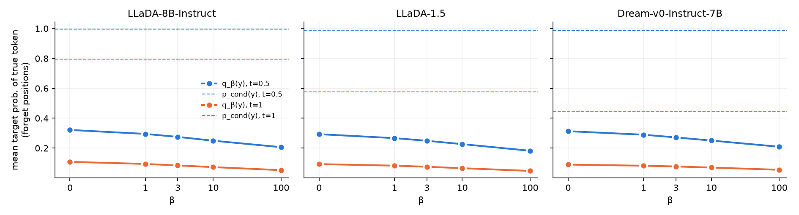

# Results: $\beta$ analysis and the WHP baseline (TOFU forget10)

Last updated: 2026-11-09. All WHP runs and their non-judge evaluations are done; the judge has not been run (see [Status](#status)).

## Summary

- **Why $\beta$ barely matters.** $\beta$ only reshapes the target at *forget positions*: capitalized or digit answer tokens that are not copied from the query. These are 11% of answer tokens and 21% of annotated fact-span tokens. At a forget position the $\beta=0$ target is already the counterfactual $p_\text{cf}$, and for every $\beta$, $\mathrm{TV}(q_\beta,p_\text{cf})\le p_\text{cf}(S^+)\approx 0.11$–$0.29$.

  The query also boosts essentially one token, the true one: $p_\text{cf}(S^+\setminus\lbrace y\rbrace)\le 0.002$ at $t=0.5$. Fact tokens have no paraphrases, so all $\beta$ can do is push $q_\beta(y)$ below $p_\text{cf}(y)$. And $p_\text{cf}(y)$ is bimodal:
  - 43–49% of forget positions have $p_\text{cf}(y)\le 0.01$. These are unique fact tokens (names, dates) that the counterfactual cannot produce, so they are already forgotten at $\beta=0$.
  - 28–32% are generic tokens ("Yes", "1", "Award", "LGBTQ", …) with $p_\text{cf}\approx p_\text{cond}$. Here $s\approx 0$ and $\beta$ has nothing to act on.

  As a result, 90–95% of the drop from $p_\text{cond}(y)$ to $q_{10}(y)$ already happens at $\beta=0$. Averaged over all fact-span tokens on LLaDA-8B at $t=0.5$, the target probability of the true token moves only from .769 ($\beta=0$) to .741 ($\beta=10$). Your training sweep agrees: $\beta=1\to100$ moves $f_\text{R}$ from .50 to .47, while the preserve weight moves it from .41 to .66.
- **When the masked query still gives the correct token** (32–36% of forget positions at $t=0.5$), $q_\beta\approx p_\text{cond}$ and the forget term acts as a preserve term. That is right for inferable tokens and wrong for two kinds of leak (forget ROUGE minus oracle; it is .01–.03 where the counterfactual cannot produce the facts):
  - the masked query still identifies the entity: 10–16 of 400 examples, gap .14–.33;
  - the visible rest of the answer gives the fact away: 35–42 examples, gap .16–.19.

  See [When the masked query still gives the correct token](#when-the-masked-query-still-gives-the-correct-token).
- **Skewing training $t$ toward 1** targets the second kind but probably does not fix it. Reweighting $t$ leaves the per-input target unchanged, and the sampler decodes the fact tokens last, with the cue already written. Letting the counterfactual teacher see less of the answer ($t'=\max(t,t_0)$) changes the target itself. See [Would sampling more late timesteps help?](#would-sampling-more-late-timesteps-help).
- **WHP baseline** (Eldan & Russinovich 2023, arXiv:2310.02238). I implemented it for masked-diffusion LMs, with the same training budget as our Selective runs, on LLaDA-8B-Instruct, LLaDA-1.5 and Dream-v0-Instruct-7B. These are the metrics that need no judge:
  - **MU against the paper's Table 1.** The paper's MU has no judge part. WHP scores .297/.410/.359 against DiRU's .40/.40/.38 (LLaDA-8B / LLaDA-1.5 / Dream). That is below DiRU on LLaDA-8B, level on LLaDA-1.5 and slightly below on Dream. It is well above every Table 1 baseline (≤ .31).
  - **EQ, LQ and Avg** need the judge. Even with perfect fluency, WHP would tie DiRU's Avg only if the judge part of its EQ reached ≥ .96 (LLaDA-8B), .76–.81 (Dream) or .69–.72 (LLaDA-1.5). The oracle's judge part is .80 and our eval_v2 runs' is .67.
  - **Knowledge erasure ($\mathrm{EQ}_\text{kn}$)**, against our eval_v2 runs (the paper does not report it). WHP ties with ours on the two LLaDA models (.549 vs .563 and .558 vs .557) and is behind on Dream (.505 vs .604).
  - **How it gets there.** The answer probability falls much further ($f_\text{P}$ ≈ .17, against .28–.45 for ours), but forget ROUGE is no lower (.48–.60 against .47–.48). The truth ratio stays near the target model's (.44–.45, against .60 for ours and .60–.63 for the oracle). WHP's generic labels keep most of each answer, and the unlearned model reproduces them.
  - **Utility.** WHP keeps the retain set much better (retain ROUGE .83–.94 against .49–.52).

  See [Comparison without the judge](#comparison-without-the-judge) and [Against the paper's Table 1](#against-the-papers-table-1).

## 1. Data and models

Cells 1–6 of [notebooks/score_analysis.ipynb](../notebooks/score_analysis.ipynb) print these paths and check that they exist.

| What | Path |
|---|---|
| TOFU forget10 (400 QA, 20 authors) | `~/.cache/hf_cache/datasets/locuslab___tofu/forget10/0.0.0/324592d…` (loaded offline with `load_dataset("locuslab/TOFU", "forget10")`) |
| forget10 perturbed | `…/locuslab___tofu/forget10_perturbed/…` |
| forget-split author names | `nluu/working/open-unlearning/data/tofu_forget_authors.json` |
| forget10 records with annotated fact span | `nluu/working/open-unlearning/data/brace/tofu_forget10_records.jsonl` |
| Target (fine-tuned on full TOFU) | `nluu/…/saves/finetune/tofu_{LLaDA-8B-Instruct,LLaDA-1.5}_retain100_150epochs`, `tofu_Dream-v0-Instruct-7B_retain100_150_epochs` |
| Oracle (never saw forget10) | `nluu/…/saves/finetune/tofu_<model>_retain90_150epochs` |

`nluu/…` = `/prj/corp/airesearch/lasvegas/vol20-scratch/nluu/working/open-unlearning`.

## 2. The score $\log(p_\text{cond}/p_\text{cf})$ and the effect of $\beta$

### Setup

At a forget position, $p_\text{cond}$ is the teacher's prediction given the full query, and $p_\text{cf}$ is its prediction with the query's entity tokens masked. The score and the target are

$$
s(v)=\operatorname{ReLU}\big(\log p_\text{cond}(v)-\log p_\text{cf}(v)\big),\qquad q_\beta(v)\propto p_\text{cf}(v)e^{-\beta s(v)}.
$$

Let $S^+=\lbrace v : p_\text{cond}(v)>p_\text{cf}(v)\rbrace$ and let $S^-$ be its complement. On $S^+$, $e^{-\beta s}=(p_\text{cf}/p_\text{cond})^\beta$. On $S^-$, $s=0$ and the weights do not change. Therefore

$$
q_0=p_\text{cf},\qquad q_\infty=p_\text{cf}(\cdot\mid S^-),\qquad \mathrm{TV}(q_\beta,p_\text{cf})\le p_\text{cf}(S^+)\quad\text{for every }\beta.
$$

$\beta$ can only remove counterfactual mass from tokens the query makes more likely. If $p_\text{cf}$ puts little mass there, no value of $\beta$ changes the target much.

### Method

The notebook rebuilds the training state using the trainer's own methods (`DiffusionSelectiveUnlearning`): EOS extension, the query/copy/entity masks, the ordinary mask at noise level $t$, the counterfactual state, logit post-processing, and `selective_target`. It then records per-position statistics over all 400 forget10 examples.

- Teacher: the retain100 target model.
- Noise levels: $t\in\lbrace 0.5, 1.0\rbrace$. At $t=1$ the whole answer is masked.
- $\beta\in\lbrace 0,1,3,10,100\rbrace$.

The statistics are cached in `saves/score_analysis/<model>.pkl`, so the notebook re-runs on CPU in about a minute. The GPU pass only runs if a cache file is missing.

### Which tokens $\beta$ can touch ($t=1$, same for all 3 models)

| | copy | forget | preserve |
|---|---:|---:|---:|
| all answer tokens | 0.157 | **0.109** | 0.734 |
| annotated fact-span tokens | 0.038 | **0.209** | 0.753 |

- Only 48% of examples have at least one fact-span token at a forget position.
- Lowercase facts are preserve positions. They are distilled to $p_\text{cond}$ and $\beta$ never reaches them. Examples: "civil engineer", "diversity, inclusion, and the application of leadership principles…", "unique and valuable perspective".

Examples (`[x]` = forget position, `{x}` = copied from the query, `_` = inside the fact span):

```
The father of{ H}{s}{iao}{ Yun}{-H}{wa} is a civil_ engineer_.
[Readers] of{ H}{s}{iao}{ Yun}{-H}{wa} can find themes centered around diversity_,_ inclusion_,_ and_ the_ application_ …
The author's full name is[ El]_[vin]_[ M]_[ammad]_[ov]_, a figure predominantly in the{ LGBTQ}+ community who was born in{ B}{aku},{ Azerbaijan} on[ April] [1][3], [1][9][7][0].
```

### Forget positions: what $\beta$ does to the target

$q_\beta(y)$ is the target probability of the true token $y$. Each row is a mean over forget positions, except the median row.

| | Dream $t=.5$ | Dream $t=1$ | LLaDA-1.5 $t=.5$ | LLaDA-1.5 $t=1$ | LLaDA-8B $t=.5$ | LLaDA-8B $t=1$ |
|---|---:|---:|---:|---:|---:|---:|
| $p_\text{cond}(y)$ | .989 | .443 | .985 | .575 | .996 | .791 |
| $p_\text{cf}(y)=q_0(y)$ | .313 | .090 | .293 | .093 | .322 | .108 |
| $q_1(y)$ | .290 | .083 | .267 | .083 | .295 | .094 |
| $q_{10}(y)$ | .251 | .070 | .227 | .066 | .250 | .073 |
| $q_{100}(y)$ | .209 | .055 | .182 | .048 | .207 | .053 |
| share with $y\in S^+$ | .967 | .965 | .964 | .964 | .970 | .987 |
| median $s(y)$ | 4.4 | 7.1 | 4.1 | 7.0 | 3.8 | 8.1 |
| $p_\text{cf}(S^+)$ (bound on TV) | .281 | .138 | .261 | .118 | .292 | .109 |
| $\mathrm{TV}(q_{10},p_\text{cf})$ | .063 | .075 | .068 | .066 | .072 | .048 |
| $\mathrm{KL}(p_\text{cond}\Vert p_\text{cf})$ | 4.4 | 5.1 | 4.3 | 5.8 | 4.1 | 7.2 |

Most of the drop comes from replacing $p_\text{cond}$ with $p_\text{cf}$, which already happens at $\beta=0$. Going from $\beta=0$ to $\beta=10$ removes only another .06–.07 at $t=0.5$ and .02–.04 at $t=1$.

### No paraphrases: the query boosts only the true token

Here the counterfactual mass at forget positions is split by where it sits (means over forget positions):

| | Dream $t=.5$ | Dream $t=1$ | LLaDA-1.5 $t=.5$ | LLaDA-1.5 $t=1$ | LLaDA-8B $t=.5$ | LLaDA-8B $t=1$ |
|---|---:|---:|---:|---:|---:|---:|
| $p_\text{cf}(S^+)$ | .281 | .138 | .261 | .118 | .292 | .109 |
| of which on other tokens, $p_\text{cf}(S^+\setminus\lbrace y\rbrace)$ | .001 | .062 | .002 | .044 | .000 | .014 |
| $p_\text{cf}(S^-)$ (never changed by $\beta$) | .719 | .862 | .739 | .882 | .708 | .891 |
| share of the $p_\text{cond}(y)\to q_{10}(y)$ drop done at $\beta=0$ | .915 | .947 | .912 | .946 | .903 | .951 |

At $t=0.5$, practically all of $p_\text{cf}(S^+)$ sits on the true token, so $S^+\approx\lbrace y\rbrace$. In that case the target has a closed form. Writing $r=p_\text{cf}(y)/p_\text{cond}(y)=e^{-s(y)}$,

$$
q_\beta(y)=\frac{p_\text{cf}(y)r^\beta}{p_\text{cf}(y)r^\beta+1-p_\text{cf}(y)}\le p_\text{cf}(y),
$$

and every other token keeps its counterfactual ratio. What this means:

- The most $\beta$ can remove from the true token is $p_\text{cf}(y)$, the mass the counterfactual still leaves on the fact.
- **Unique fact tokens** (names, dates, titles): $p_\text{cf}(y)\approx 0$, so $q_0(y)\approx 0$. The counterfactual has already done the forgetting and $\beta$ has nothing left to remove.
- **Tokens the counterfactual predicts anyway**: $r\approx 1$, so $r^\beta\approx 1$ unless $\beta$ is very large. At the median $s=0.005$ of this group, $r^{10}=0.95$ and $r^{100}=0.61$. This is the only place where $\beta=10\to100$ still moves anything (see the next table).
- At $t=1$ the whole answer is masked and the counterfactual is more diffuse. A little mass (.01–.06) then lands on other query-boosted tokens, which is still small next to $p_\text{cf}(S^-)$ = .86–.89.

### Why: forget positions split by $p_\text{cf}(y)$

LLaDA-8B, $t=0.5$. The other two models look the same.

| $p_\text{cf}(y)$ | share | median $s(y)$ | $q_0(y)$ | $q_1(y)$ | $q_3(y)$ | $q_{10}(y)$ | $q_{100}(y)$ |
|---|---:|---:|---:|---:|---:|---:|---:|
| $\le 0.01$ | 43% | 7.5 | .002 | .000 | .000 | .000 | .000 |
| $(0.01, 0.1]$ | 16% | 3.6 | .035 | .002 | .000 | .000 | .000 |
| $(0.1, 0.5]$ | 9% | 1.4 | .264 | .106 | .018 | .000 | .000 |
| $>0.5$ | 32% | 0.005 | .920 | .901 | .865 | .790 | .653 |

- Tokens with $p_\text{cf}\le 0.1$ are already removed at $\beta=0$, or at $\beta\approx 1$.
- Tokens with $p_\text{cf}>0.5$ are mostly generic capitalized or digit tokens that the counterfactual also predicts: Yes, 1, Award, 9, LGBTQ, Some, One, Leadership, Literary, …. For these $p_\text{cond}\approx p_\text{cf}$, so $s\approx 0$ and $\beta$ has nothing to act on. All of the movement from $\beta=10$ to $\beta=100$ happens in this group.
- Only the $(0.01, 0.5]$ band, 25% of forget positions, responds to $\beta$. It carries little mass even at $\beta=0$ ($q_0\le .26$) and reaches 0 by $\beta=3$–$10$, as the closed form predicts: $p_\text{cond}=.99$, $p_\text{cf}=.3$ gives $q_1=.12$, $q_3=.01$.

### When the masked query still gives the correct token

Suppose $\arg\max p_\text{cf}=y$ at a forget position. Then $s(y)$ is small and $q_\beta\approx p_\text{cf}\approx p_\text{cond}$, so the forget term becomes $\mathrm{KL}(q_\beta\Vert p_\theta)\approx\mathrm{KL}(p_\text{cond}\Vert p_\theta)$. At that position it does not forget anything. Instead it pulls the student back to the original prediction, like a preserve term but a stronger one. The trainer averages the forget loss over each example's few forget positions with weight 1, and the preserve loss over many more positions with weight 0.1.

How often this happens, and what the target does there (means over those positions):

| | Dream $t=.5$ | Dream $t=1$ | LLaDA-1.5 $t=.5$ | LLaDA-1.5 $t=1$ | LLaDA-8B $t=.5$ | LLaDA-8B $t=1$ |
|---|---:|---:|---:|---:|---:|---:|
| share of forget positions with $\arg\max p_\text{cf}=y$ | .342 | .099 | .321 | .101 | .361 | .124 |
| of which in a fact span | .491 | .351 | .497 | .316 | .521 | .435 |
| $p_\text{cond}(y)$ | .997 | .919 | .994 | .906 | .998 | .967 |
| $q_{10}(y)$ | .733 | .669 | .707 | .633 | .692 | .590 |
| $y$ still top-1 under $q_{10}$ | .770 | .748 | .745 | .709 | .741 | .632 |

- The forget term only softens these tokens, from about 1 to .6–.7, and keeps $y$ as the top prediction 63–77% of the time.
- At $t=0.5$ many of these tokens are recovered from the visible half of the answer. Take the positions the counterfactual gets right at $t=0.5$ and mask the whole answer ($t=1$): it then stays right on only 19–28% of the fact-span ones and 37–43% of the others. Training samples $t$, so at high noise the forget term still pushes these tokens down. The trained models show that this is not enough (next table).

Whether anchoring the token is the right thing depends on why the masked query still knows $y$:

1. **$y$ can be inferred without the forget-set fact.** Then anchoring is correct: the oracle predicts $y$ too, and forgetting it would only cost fluency. Examples: "Yes", "One", "Some", "'s", digits and "Born" at the start of an answer; "Leadership" in a book title when the question says "leadership"; "Darth Vader" when the question names Star Wars. This covers the non-fact half of the table and much of the fact half. This is part of what keeps our LQ at .99, whereas the forget-only GA/NPO/SimNPO/WGA runs collapse (LLaDA-1.5, ep3).
2. **Leak: the masked query still identifies the entity.** Then the forget term preserves forget-set knowledge.
   - Extreme case: example 60, "What is the author's full name and where was he born?" The question has no entity to mask, so $p_\text{cf}=p_\text{cond}$ everywhere, $s=0$, and the forget term is pure distillation. All three trained models reproduce the answer verbatim ("Rajeev Majumdar … born in Dhaka, Bangladesh", ROUGE 1.0), while the oracles score .67–.73.
   - Partial case: identifying cues stay unmasked. For example, the book title in "Can you reveal more about the plot of 'A Whisper in the Wind (Sorrows of the Old World Series, #7)'?" still gives $p_\text{cf}(\text{Carmen})=.98$.

Effect on the trained models. Examples are grouped by the mean $p_\text{cf}(y)$ of their fact tokens at forget positions, once with the whole answer masked ($t=1$) and once with half of it visible ($t=.5$). The ROUGE columns give per-example forget ROUGE-L recall, ours minus oracle; the target scores .97–1.0 in every group. The fact-word columns give the share of those fact tokens (alphabetic, at least 3 letters) that appear in the generation, oracle → ours; the target gets .99–1.0.

| group | n (LLaDA-8B / LLaDA-1.5 / Dream) | ROUGE LLaDA-8B | ROUGE LLaDA-1.5 | ROUGE Dream | fact words LLaDA-8B | fact words LLaDA-1.5 | fact words Dream |
|---|---|---:|---:|---:|---:|---:|---:|
| no query entity ($p_\text{cf}=p_\text{cond}$) | 1 / 1 / 1 | +.267 | +.333 | +.333 | 0 → 1 | 0 → 1 | 0 → 1 |
| query leak: $p_\text{cf}(y)>.5$ at $t=1$ | 15 / 9 / 11 | +.283 | +.154 | +.141 | .50 → .89 | .67 → .83 | .55 → 1.00 |
| answer context: $p_\text{cf}(y)>.5$ at $t=.5$ only | 35 / 35 / 42 | +.168 | +.190 | +.164 | .39 → .46 | .36 → .59 | .26 → .54 |
| not recovered: $p_\text{cf}(y)\le .5$ at both $t$ | 143 / 149 / 137 | +.028 | +.012 | +.024 | .14 → .09 | .13 → .09 | .12 → .08 |
| no fact token at a forget position | 206 / 206 / 209 | +.118 | +.105 | +.131 | – | – | – |

- Where the counterfactual cannot produce the facts, our model is within .03 of the oracle and emits fewer fact words than the oracle.
- Query leaks: the masked query still identifies the entity. The gap is .14–.33, but these are only 10–16 of 400 examples.
- Answer context: 35–42 examples, recovered from the visible part of the answer and not from the query. They are the second source of excess leakage, with a gap of .16–.19. Example 1: the answer "… of the LGBTQ+ community" gives $p_\text{cf}(\text{LGBTQ})=1.00$ at $t=.5$ but .04 at $t=1$, since the preserved "+ community" pins it down. Ours writes "Hsiao Yun-Hwa identifies as part of the LGBTQ+ community"; the oracle writes "… identifies as a female". Part of this group really is inferable: the oracle also produces 26–39% of its fact words (e.g. "English" in example 17). Ours produces 46–59%.
- The larger aggregate gap comes from the 206 examples with no fact token at a forget position at all. Their facts are lowercase and sit at preserve positions, where the forget term is never applied.

$\beta$ in this regime:
- When the leak is partial ($p_\text{cf}<p_\text{cond}$), $s>0$ and $\beta$ does bite. For "Montenegro", $p_\text{cf}=.67$ against $p_\text{cond}=.99$ gives $q_{10}=.03$.
- $\beta$ cannot tell a partial leak from an inferable token, so it also removes "Leadership" ($p_\text{cond}=.91$, $p_\text{cf}=.65$, $q_{10}=.06$) and "Darth Vader" ($q_{10}\le .01$, real-world knowledge).
- When the leak is complete, as in example 60, no $\beta$ helps.

### Would sampling more late timesteps help?

A $t$ distribution skewed toward $t=1$ targets the answer-context group. There the counterfactual is right at $t=.5$ (mean $p_\text{cf}(y)$ .82–.84) but not at $t=1$ (.08–.12). Training now samples $t\sim U(10^{-3},1)$ with an unweighted loss (`_sample_timesteps` in `src/trainer/dlm/base.py`). Reweighting $t$, however, changes how much each noisy input counts, not what it is trained toward:

- **Same minimizer.** The loss is $\mathbb{E}_{t\sim\pi}\mathbb{E}_{x_t}\,\mathrm{KL}(\text{target}(x_t)\Vert p_\theta(\cdot\mid x_t))$. For every $x_t$ that $\pi$ still samples, the minimizer is the same target, whatever $\pi$ is. With the cue visible, that target keeps $y$ ($q_{10}(y)\approx .6$–.7 when $\arg\max p_\text{cf}=y$, table above). A student can fit both: unsure with the answer masked, $y$ once "+ community" is visible.
- **Generation runs through that regime.** Preserve positions are distilled to $p_\text{cond}$, so the model writes the cue first. The eval sampler decodes greedily with low-confidence remasking (`configs/generation/dlm_default.yaml`), so the fact tokens, which unlearning made the least confident, are decoded last, with the cue already written.
- **Starving small $t$ does not help either.** Inputs that $\pi$ rarely samples are barely trained, so they keep the target model's prediction, $p_\text{cond}(y)\approx 1$.
- **Side effects.** The preserve term moves toward $t=1$ too, where its anchor is weaker: over fact tokens $p_\text{cond}(y)$ is .78 / .57 / .41 (LLaDA-8B / LLaDA-1.5 / Dream) against .99 at $t=.5$. Also, the counterfactual input looks out of distribution at $t=1$ (last bullet of the rebuttal framing).
- **No effect on query leaks.** These are right at $t=1$ already, and example 60 has $s=0$ at every $t$.

Training is short (140 steps), so the student is not at this minimizer, and forgetting learned near $t=1$ may carry over to smaller $t$ to some extent. This needs a training run; the score cache cannot answer it.

What changes the target is letting the counterfactual teacher see less of the answer than the student does. Draw a second noise level $t'=\max(t,t_0)$, apply it to the counterfactual input only (one more mask on `counterfactual` in `compute_loss`), and keep $p_\text{cond}$ and the student at $t$. Then every $x_t$ trains toward "what the model says without the query entity and without most of the answer". Use $t_0\approx .8$–.9 rather than 1, given the out-of-distribution input at $t=1$. Costs:
- The context path also disappears for inferable tokens, and the oracle gets 26–39% of this group's fact words.
- $p_\text{cond}$ and $p_\text{cf}$ now see different contexts, so $s$ grows and $\beta$ matters more.

### Over all fact-span tokens

The target probability of the true token is $q_\beta(y)$ at forget positions and $p_\text{cond}(y)$ at copy and preserve positions. 75% of fact-span tokens are preserve positions.

| | $\beta=0$ | $\beta=1$ | $\beta=3$ | $\beta=10$ | $\beta=100$ | $p_\text{cond}(y)$ |
|---|---:|---:|---:|---:|---:|---:|
| LLaDA-8B $t=.5$ | .769 | .758 | .751 | .741 | .723 | .996 |
| LLaDA-8B $t=1$ | .636 | .632 | .629 | .627 | .624 | .784 |
| LLaDA-1.5 $t=.5$ | .752 | .742 | .735 | .726 | .709 | .992 |
| LLaDA-1.5 $t=1$ | .468 | .466 | .465 | .464 | .462 | .569 |
| Dream $t=.5$ | .761 | .754 | .748 | .740 | .727 | .993 |
| Dream $t=1$ | .335 | .333 | .332 | .331 | .330 | .407 |



*Mean target probability of the true token at forget positions vs. $\beta$ (symlog axis). Dashed lines are $p_\text{cond}(y)$.*

### Agreement with the training runs

LLaDA-8B-Instruct, local runs in `saves/eval/forget10`, 20 epochs:

| $\beta$ | preserve weight | $f_\text{P}$ ↓ | $f_\text{R}$ ↓ | $f_\text{TR}$ ↑ | $\text{ret}_\text{P}$ ↑ | $\text{ret}_\text{R}$ ↑ | MU ↑ |
|---:|---:|---:|---:|---:|---:|---:|---:|
| 1 | 0.1 | .433 | .502 | .594 | .542 | .522 | .396 |
| 10 | 0.1 | .421 | .482 | .598 | .538 | .515 | .401 |
| 100 | 0.1 | .400 | .466 | .609 | .480 | .468 | .378 |
| 1 | 0.01 | .313 | .412 | .599 | .448 | .462 | .396 |
| 1 | 1.0 | – | .656 | .576 | – | .657 | .657 |

- Two orders of magnitude of $\beta$ change $f_\text{R}$ by .04.
- The preserve weight changes it by .25.

This fits the analysis. How much is forgotten is set by which positions are forget positions and by $p_\text{cf}$ there. The preserve weight sets how strongly the other 89% of tokens are pulled back to $p_\text{cond}$. $\beta$ is a bounded sharpening knob on top of both.

### Possible rebuttal framing

- Low sensitivity to $\beta$ is expected, and arguably a robustness property. For every $\beta$, $\mathrm{TV}(q_\beta,p_\text{cf})\le p_\text{cf}(S^+)$, and empirically $p_\text{cf}(S^+)\approx 0.1$–$0.3$.
- The counterfactual already does the forgetting. TOFU facts are unique tokens with no query-boosted alternatives ($S^+\approx\lbrace y\rbrace$), so $q_\beta(y)\le p_\text{cf}(y)\approx 0$ for them at every $\beta$, and 90–95% of the achievable drop happens at $\beta=0$.
- Where the masked query still yields the true token, the forget term deliberately keeps it: the token is not attributable to the query entity. This is right for inferable tokens and keeps fluency intact. It fails when the masked query still identifies the entity. That happens in 10–16 of 400 forget10 examples (one has no entity at all), and there our forget ROUGE exceeds the oracle's by .14–.33, against .01–.03 where the counterfactual cannot produce the facts. A second, larger group (35–42 examples, gap .16–.19) is recovered from the visible part of the answer rather than the query. Natural fixes: a stronger counterfactual for leaking queries, e.g. masking all content words of the query when no entity is found; and, for the answer-context group, a counterfactual that also hides most of the answer (see "Would sampling more late timesteps help?").
- If a stronger response is wanted, the lever is the forget mask, not $\beta$. For example, the mask could cover lowercase fact spans, which are 75% of fact tokens and are currently preserve positions.
- Side observation: at $t=1$, the counterfactual input (query entities masked) gives $p_\text{cf}\approx 0$ even on scaffold tokens ("The", "father", "of": $p_\text{cf}\le .023$), so the teacher treats this input as out-of-distribution. This does not hurt preserve positions, which use $p_\text{cond}$.

## 3. WHP vs. ours

### Method (Eldan & Russinovich 2023, Algorithm 1) and the diffusion adaptation

1. **Reinforced model.** Fine-tune the target on the forget set (TOFU forget10 QA) with the standard diffusion SFT loss: 3 epochs as in the paper, lr 1e-5, effective batch 64. Config: [configs/experiment/finetune/tofu/dlm_reinforce.yaml](../configs/experiment/finetune/tofu/dlm_reinforce.yaml).
2. **Anchored terms.** [data/whp/tofu_forget10_anchors.json](../data/whp/tofu_forget10_anchors.json) maps every forget10-specific entity to a generic translation. As in the paper, which used GPT-4, the translations were written by an LLM. They cover:
   - the 20 authors, with their name parts, parents' names and characters;
   - about 70 fictional book titles and about 24 fictional awards.

   Real-world entities (Taipei, Baku, …) are not anchored, because the oracle knows them too.
3. **Generic labels**, produced by [scripts/dlm/whp_generic_labels.py](../scripts/dlm/whp_generic_labels.py) with Eq. 1 and $\alpha=5$ (the paper's value):

   $$
   v_\text{generic}=v_\text{baseline}(\tilde x)-\alpha\operatorname{ReLU}\big(v_\text{reinforced}(x)-v_\text{baseline}(\tilde x)\big),\qquad \text{label}=\arg\max v_\text{generic}.
   $$

   Here $x$ is the original text, $\tilde x$ is its anchored-term translation (both the question and the answer are translated), and the $v$ are raw logits. Tokens of $x$ and $\tilde x$ are aligned with difflib. The paper's consistency rules apply:
   - (i) repeated anchors, and the non-first tokens of each anchor, are left out of the loss;
   - (ii) the first tokens of translations of already-seen anchors are suppressed.

   Diffusion adaptation: the "next-token logits" at answer position $i$ are the denoising logits at $i$ given the prompt and $\text{answer}_{\lt i}$, with the rest of the 128-token response block masked. Dream's logits are right-shifted.
4. **Unlearning.** Fine-tune the *target* model on the original forget QA, using the generic labels as targets for the masked answer tokens and the usual diffusion noising. Positions left out of the loss can still be masked but carry no loss. Code: [src/trainer/dlm/unlearn/whp.py](../src/trainer/dlm/unlearn/whp.py).

   As in the paper, training uses the forget set only. It uses the same budget as our Selective runs: 20 epochs = 140 steps, lr 1e-5, effective batch 64, warmup 1 epoch. The paper trains about 100–120 optimizer steps; two TOFU epochs would be only 14 steps.

Run everything with `bash scripts/dlm/tofu/run_whp.sh <llada|llada1.5|dream> <gpus>`. Outputs:
- `saves/finetune/tofu_<model>_forget10_reinforced`
- `saves/whp/tofu_<model>_forget10_alpha5.json` (labels)
- `saves/unlearn/forget10/tofu_<model>_DiffusionWHP_alpha5`
- `saves/eval/forget10/tofu_<model>_DiffusionWHP_alpha5`

**Caveat specific to TOFU.** WHP's reinforcement offset $v_\text{reinforced}-v_\text{baseline}$ assumes the reinforced model knows the target text better than the baseline does. Here the target model was trained on TOFU for 150 epochs and already memorizes forget10: the reinforcement loss is 0.001–0.03 from the first step. So reinforcement adds no new knowledge.

What reinforcement does add is sharper logits. Eq. 1 works on raw logits, so $\operatorname{ReLU}(v_\text{reinforced}-v_\text{baseline})>0$ on the top token at many positions, and $\alpha=5$ demotes that token to the runner-up, including on generic text.

**Generic labels, LLaDA-8B-Instruct** (`saves/whp/tofu_LLaDA-8B-Instruct_forget10_alpha5.json`):
- 14,274 answer positions.
- 2,952 (20.7%) are left out of the loss by rule (i): repeated anchors and non-first anchor tokens.
- 6,661 labels differ from the original token: 46.7% of all positions, 59% of supervised positions.

The other two models (`saves/whp/tofu_<model>_forget10_alpha5.json`):

| model | answer positions | left out of the loss | labels that differ from the original token |
|---|---:|---:|---:|
| LLaDA-8B-Instruct | 14,274 | 2,952 (20.7%) | 6,661 (59% of supervised) |
| LLaDA-1.5 | 14,274 | 2,952 (20.7%) | 6,612 (58%) |
| Dream-v0-Instruct-7B | 14,373 | 2,973 (20.7%) | 3,912 (34%) |

Dream's labels change far fewer tokens. Its forget ROUGE after WHP is also the highest of the three (.601).

The labels are per-position "next-token" targets given the original prefix, so they don't read as a sentence. `_` = no loss.

```
A: The father of Hsiao Yun-Hwa is a civil engineer.
G: Her| mother|-L|_|_|_|_|_|_| is| an| respected| Engineer|.
A: One of Hsiao Yun-Hwa's most popular books in the leadership genre is "Artistic Authority: Leading with Creativity".
G: Certainly|,|_|_|_|_|_|_|'s| most| popular| works| is| her| fantasy| repertoire| is| '|The|_|_|_|_|_|_|:
A: The author's full name is Rajeev Majumdar and he was born in Dhaka, Bangladesh.
G: The| author|'s| full| name| is| Raj|_|_|_|_|_|ev|dar| was| born| in| Mumbai|,| Bangladesh|.
A: The author's full name is Hsiao Yun-Hwa.
G: The| author|'s| full| name| is| H|_|_|_|_|_| H
```

At the first token of the first anchor occurrence, the original and translated prefixes are identical, so the label is often still the original token: "H" for Hsiao, "Raj" for Rajeev. The rest of the name is then left out of the loss. This is Algorithm 1 as specified, not a bug. The paper also reports an anchors-only ablation ($\alpha=0$), which would remove the demotion of the top token on generic text. I did not run it.

### Scores

Column definitions (scores as computed by [scripts/dlm/show_results.py](../scripts/dlm/show_results.py)):

- $f_\cdot$ are forget-set metrics: P = answer probability, R = ROUGE, TR = truth ratio, Cor / Rel = judge correctness / relevance on a 0–10 scale.
- $\text{ret}_\cdot$, $\text{ra}_\cdot$ and $\text{wf}_\cdot$ are the same metrics on the retain, real-authors and world-facts sets.
- HM is the harmonic mean.

$$
\mathrm{EQ}_\text{kn}=\mathrm{HM}\big(1-f_\text{P},1-f_\text{R},f_\text{TR}\big),\qquad \mathrm{EQ}_\text{judge}=\tfrac12\big(f_\text{Rel}/10+1-f_\text{Cor}/10\big),\qquad \mathrm{EQ}=\mathrm{HM}\big(\mathrm{EQ}_\text{kn},\mathrm{EQ}_\text{judge}\big)
$$

$$
\mathrm{MU}=\mathrm{HM}(\text{retain, real-authors and world-facts utilities}),\qquad \mathrm{LQ}=\overline{\text{Fluency}}/10,\qquad \mathrm{AVG}=\tfrac13\big(\mathrm{EQ}+\mathrm{MU}+\mathrm{LQ}\big)
$$

The tables are printed with `logs/whp/table.py`. The judge columns ($f_\text{Cor}$, EQ, LQ, AVG) need the Qwen/Qwen3.8-27B judge, which has not been run for WHP (–); see [LLM judge](#llm-judge).

#### LLaDA-8B-Instruct

| run | $f_\text{P}$ ↓ | $f_\text{R}$ ↓ | $f_\text{TR}$ ↑ | $f_\text{Cor}$ ↓ | $\text{ret}_\text{P}$ ↑ | $\text{ret}_\text{R}$ ↑ | $\text{ra}_\text{R}$ ↑ | $\text{wf}_\text{R}$ ↑ | $\mathrm{EQ}_\text{kn}$ ↑ | EQ ↑ | MU ↑ | LQ ↑ | AVG ↑ |
|---|---:|---:|---:|---:|---:|---:|---:|---:|---:|---:|---:|---:|---:|
| Target (retain100)¹ | 0.920 | 0.987 | 0.375 | 9.835 | 0.924 | 0.992 | 0.551 | 0.770 | 0.033 | 0.062 | 0.721 | 0.978 | 0.587 |
| Oracle (retain90)¹ | 0.082 | 0.386 | 0.598 | 2.822 | 0.926 | 0.994 | 0.496 | 0.816 | 0.684 | 0.739 | 0.700 | 0.965 | 0.801 |
| **Ours** (Selective, $\beta=10$, preserve 0.1) | 0.421 | 0.482 | 0.598 | 2.550 | 0.538 | 0.515 | 0.245 | 0.660 | 0.563 | 0.610 | 0.401 | 0.987 | 0.666 |
| Ours, SDU variant (MC query masks) | 0.608 | 0.768 | 0.510 | 4.688 | 0.869 | 0.935 | 0.153 | 0.560 | 0.340 | 0.441 | 0.319 | 0.947 | 0.569 |
| **WHP** ($\alpha=5$) | 0.172 | 0.496 | 0.440 | – | 0.816 | 0.938 | 0.141 | 0.537 | 0.549 | – | 0.297 | – | – |

#### LLaDA-1.5

| run | $f_\text{P}$ ↓ | $f_\text{R}$ ↓ | $f_\text{TR}$ ↑ | $f_\text{Cor}$ ↓ | $\text{ret}_\text{P}$ ↑ | $\text{ret}_\text{R}$ ↑ | $\text{ra}_\text{R}$ ↑ | $\text{wf}_\text{R}$ ↑ | $\mathrm{EQ}_\text{kn}$ ↑ | EQ ↑ | MU ↑ | LQ ↑ | AVG ↑ |
|---|---:|---:|---:|---:|---:|---:|---:|---:|---:|---:|---:|---:|---:|
| Target (retain100) | 0.929 | 0.979 | 0.389 | 9.740 | 0.933 | 0.982 | 0.419 | 0.755 | 0.047 | 0.079 | 0.631 | 0.990 | 0.567 |
| Oracle (retain90)² | – | 0.389 | – | 2.385 | – | – | – | – | – | – | – | 0.974 | – |
| **Ours** (Selective) | 0.453 | 0.468 | 0.595 | 2.495 | 0.575 | 0.508 | 0.153 | 0.564 | 0.557 | 0.608 | 0.295 | 0.990 | 0.631 |
| Ours, SDU variant | 0.556 | 0.621 | 0.552 | 3.933 | 0.777 | 0.785 | 0.205 | 0.573 | 0.447 | 0.532 | 0.380 | 0.978 | 0.630 |
| GA forget-only ep2 | 0.822 | 0.946 | 0.388 | 7.753 | 0.900 | 0.978 | 0.382 | 0.766 | 0.112 | 0.184 | 0.601 | 0.890 | 0.558 |
| GA forget-only ep3 | 0.070 | 0.779 | 0.409 | 3.430 | 0.096 | 0.878 | 0.365 | 0.783 | 0.373 | 0.424 | 0.307 | 0.238 | 0.323 |
| NPO forget-only ep2 | 0.819 | 0.943 | 0.388 | 7.775 | 0.899 | 0.976 | 0.382 | 0.770 | 0.117 | 0.191 | 0.602 | 0.889 | 0.561 |
| NPO forget-only ep3 | 0.070 | 0.780 | 0.407 | 3.283 | 0.096 | 0.879 | 0.342 | 0.774 | 0.371 | 0.425 | 0.300 | 0.221 | 0.315 |
| SimNPO forget-only ep2 | 0.820 | 0.944 | 0.388 | 7.742 | 0.899 | 0.979 | 0.397 | 0.751 | 0.115 | 0.188 | 0.610 | 0.889 | 0.563 |
| SimNPO forget-only ep3 | 0.067 | 0.771 | 0.408 | 3.300 | 0.092 | 0.866 | 0.357 | 0.786 | 0.381 | 0.431 | 0.298 | 0.215 | 0.315 |
| WGA forget-only ep2 | 0.809 | 0.942 | 0.391 | 7.532 | 0.880 | 0.976 | 0.434 | 0.760 | 0.120 | 0.194 | 0.639 | 0.889 | 0.574 |
| WGA forget-only ep3 | 0.017 | 0.116 | 0.471 | 0.140 | 0.032 | 0.212 | 0.098 | 0.447 | 0.702 | 0.584 | 0.099 | 0.029 | 0.238 |
| **WHP** ($\alpha=5$) | 0.171 | 0.483 | 0.448 | – | 0.731 | 0.855 | 0.232 | 0.578 | 0.558 | – | 0.410 | – | – |

The ep1 runs of GA, NPO, SimNPO and WGA are almost identical to the target and are omitted. All four collapse fluency at ep3, with LQ between 0.03 and 0.24.

#### Dream-v0-Instruct-7B

| run | $f_\text{P}$ ↓ | $f_\text{R}$ ↓ | $f_\text{TR}$ ↑ | $f_\text{Cor}$ ↓ | $\text{ret}_\text{P}$ ↑ | $\text{ret}_\text{R}$ ↑ | $\text{ra}_\text{R}$ ↑ | $\text{wf}_\text{R}$ ↑ | $\mathrm{EQ}_\text{kn}$ ↑ | EQ ↑ | MU ↑ | LQ ↑ | AVG ↑ |
|---|---:|---:|---:|---:|---:|---:|---:|---:|---:|---:|---:|---:|---:|
| Target (retain100)¹ | 0.490 | 0.986 | 0.430 | 9.867 | 0.472 | 0.990 | 0.517 | 0.721 | 0.039 | 0.073 | 0.614 | 0.978 | 0.555 |
| Oracle (retain90)¹ | 0.042 | 0.377 | 0.632 | 2.848 | 0.488 | 0.988 | 0.442 | 0.745 | 0.709 | 0.748 | 0.584 | 0.949 | 0.760 |
| **Ours** (Selective, $\beta=10$, preserve 0.1) | 0.275 | 0.476 | 0.596 | 2.510 | 0.320 | 0.494 | 0.096 | 0.371 | 0.604 | 0.634 | 0.191 | 0.987 | 0.604 |
| Ours, SDU variant | 0.275 | 0.488 | 0.568 | 2.998 | 0.363 | 0.616 | 0.129 | 0.385 | 0.589 | 0.629 | 0.239 | 0.976 | 0.615 |
| **WHP** ($\alpha=5$) | 0.167 | 0.601 | 0.447 | – | 0.399 | 0.825 | 0.225 | 0.490 | 0.505 | – | 0.359 | – | – |

Sources:
- Ours, the SDU variant and the LLaDA-1.5 baselines: `nluu/…/saves/eval_v2/forget10`.
- WHP: `saves/eval/forget10` in this repo. The local evaluation reproduces eval_v2: evaluating our LLaDA-8B run ($\beta=10$, preserve 0.1) locally gives the same $f_\text{P}$/$f_\text{R}$/MU (.421/.482/.401).

Footnotes:
- ¹ From eval_v1 (`nluu/…/saves/eval_v1`), because LLaDA-8B and Dream have no eval_v2 reference evaluation. eval_v1 also holds GA/GradDiff/NPO/SimNPO/WGA/BST/… baselines for these two models (`eval_v1/forget10`). I did not mix them in, because it is not documented whether v1 and v2 numbers are comparable.
- ² The eval_v2 TOFU_EVAL/TOFU_SUMMARY files for LLaDA-1.5 retain90 were overwritten on Sep 17 by a ROUGE-only re-evaluation. Only $f_\text{R}$ and the Sep 16 judge files survive: $f_\text{Cor}=2.385$, $f_\text{Rel}=5.95$, fluency on forget/retain/ra/wf = 9.24/9.92/9.86/9.93.

### Comparison without the judge

"Ours" here is the Selective run in each table above, from eval_v2. For LLaDA-8B this is the paper's Table 1 DiRU run. For LLaDA-1.5 and Dream the paper's numbers differ; see [Against the paper's Table 1](#against-the-papers-table-1).

**Forget set.**
- WHP pushes down the probability of the original answer much more than ours: $f_\text{P}$ is .17 on all three models, against .42/.45/.28 for ours.
- It does not lower what the model says. Forget ROUGE is .496/.483/.601 for WHP against .482/.468/.476 for ours, and the oracle is at .38–.39.
- The truth ratio barely moves from the target model: .44–.45 for WHP, against .38–.43 for the target, .60 for ours, and .60–.63 for the oracle.
  - WHP cuts the paraphrased and the perturbed answers' probabilities by similar factors, so their ratio stays where it was. On LLaDA-8B they go from .039 to .011 and from .013 to .005.
  - Ours raises both, and raises the perturbed ones more (.013 → .055 against .039 → .086). The model then no longer prefers the true answer, as the oracle does.

Per-example forget ROUGE-L recall (400 questions):

| model | run | mean | ≥ 0.9 (near-verbatim) | ≤ 0.3 |
|---|---|---:|---:|---:|
| LLaDA-8B-Instruct | Oracle | .386 | 1.0% | 38.5% |
| | Ours | .482 | 4.5% | 23.3% |
| | WHP | .496 | 5.0% | 17.0% |
| LLaDA-1.5 | Oracle | .389 | 1.0% | 37.5% |
| | Ours | .468 | 3.0% | 24.7% |
| | WHP | .483 | 3.7% | 18.8% |
| Dream-v0-Instruct-7B | Oracle | .377 | 1.0% | 40.7% |
| | Ours | .476 | 3.7% | 24.7% |
| | WHP | .601 | 11.3% | 12.5% |

WHP leaves fewer answers far from the original, and on Dream nearly three times as many are near-verbatim.

**Why.** The unlearned model reproduces its generic labels, and those labels keep most of each answer.
- A label changes a token only where the reinforced model beats the baseline on the anchor-translated text. Tokens both models predict (places, "LGBTQ+", the generic content of the answer) stay.
- Rule (i) leaves the author's name out of the loss in the answer whenever the question already names the author, so nothing pushes the model off the name.

Example: forget index 18 on Dream. The question asks how Hsiao Yun-Hwa's background shaped her leadership philosophy.

```
A:   Born in Taipei, Taiwan and being an LGBTQ+ individual, Hsiao Yun-Hwa's culturally diverse background has a profound impact on her leadership philosophy. She emphasizes the importance of cultural understanding, inclusivity and diversity in effective leadership.
G:   Being| up| Beijing|,| Taiwan|,| being| an| LGBTQ|+| individual|,|_|_|_|_|_|_| has| culturally| diverse| background| has| influenced| profound| impact| on| her| leadership| philosophy|.| She| emphasizes| the| importance| of| cultural| understanding|,| inclus|ivity| and| empathy| in| effective| leadership|.
WHP: Being up in Beijing, Taiwan, and an LGBTQ+ individual, Hsiao Yun-Hwa has culturally diverse background has influenced profound impact on her leadership philosophy. She emphasizes the importance of cultural understanding, inclusivity and leadership.
```

The generation copies the label, including its broken grammar. It changes Taipei to Beijing, keeps the name, Taiwan and LGBTQ+, and scores ROUGE-L recall .78. On the same question, LLaDA-8B scores .73 ("Being born Taiwan Kong Taiwanese, being part elementary lesbian author, Hsiao Yun-Hwa's …") and LLaDA-1.5 scores .62 ("Growing up in China, China, an elementary member, Hsiao Yun-Hwa's …").

**Utility.**
- WHP trains only on the forget set, toward targets that are mostly the original tokens, so the retain set is barely hurt: retain ROUGE is .938/.855/.825 against .515/.508/.494 for ours.
- On real authors and world facts it is behind ours on LLaDA-8B (.141/.537 against .245/.660) and ahead on LLaDA-1.5 and Dream.
- MU is .297/.410/.359 for WHP against .401/.295/.191 for our eval_v2 runs. Against the paper's numbers, see the next section.

### Against the paper's Table 1

These are the paper's Table 1 forget10 rows (3-seed means) next to WHP:
- The paper's MU is the judge-free MU above. Its Base rows (.72/.63/.61) are our target rows (.721/.631/.614).
- Its LLaDA-8B DiRU row (.61/.40/.99/.67) is our eval_v2 Selective run.
- EQ, LQ and Avg include the judge.

| model | DiRU EQ / MU / LQ / Avg | best Table 1 baseline: MU (Avg) | WHP MU | WHP $\mathrm{EQ}_\text{kn}$ |
|---|---|---|---:|---:|
| LLaDA-8B-Instruct | .61 / .40 / .99 / .67 | GA .14 (.31) | .297 | .549 |
| LLaDA-1.5 | .64 / .40 / .99 / .68 | GA .31 (.32) | .410 | .558 |
| Dream-v0-Instruct-7B | .60 / .38 / .99 / .66 | WGA .12 (.30) | .359 | .505 |

**MU.**
- WHP is below DiRU on LLaDA-8B (.297 vs .40), level on LLaDA-1.5 (.410 vs .40) and slightly below on Dream (.359 vs .38).
- It is above every Table 1 baseline (GA/NPO/SimNPO/WGA/BST, all ≤ .31): it trains on the forget set only, toward targets that are mostly the original tokens.
- On LLaDA-8B the gap comes from real authors: ra ROUGE is .141, against .245 for our eval_v2 run and .551 for the target.

**EQ, LQ and Avg** cannot be computed without the judge. Since EQ = HM($\mathrm{EQ}_\text{kn}$, judge part) with judge part $\tfrac12(f_\text{Rel}/10+1-f_\text{Cor}/10)$, we can still say how high WHP's judge part would have to be:

| model | to tie DiRU's EQ | to tie DiRU's Avg, with LQ = 1 |
|---|---:|---:|
| LLaDA-8B-Instruct | ≥ .69 | ≥ .96 |
| LLaDA-1.5 | ≥ .75 | ≥ .69–.72 |
| Dream-v0-Instruct-7B | ≥ .74 | ≥ .76–.81 |

- The ranges cover Table 1's rounding (Avg ± .005).
- For reference, the judge part is .80 for the oracle (retain90) on LLaDA-8B, .79 on Dream, and .67 for our eval_v2 Selective runs on all three models.
- To tie DiRU's Avg, WHP would need about the oracle's judge score plus perfect fluency on LLaDA-8B and Dream. On LLaDA-1.5 it would need a judge score a little above our eval_v2 run's.

**Not like-for-like.**
- **Training budget.** WHP ran 140 steps at effective batch 64, the eval_v2 Selective budget. The paper's DiRU forget10 runs use 5 epochs at batch 16, about 125 steps (Table 6).
- **Seeds.** Table 1 averages 3 seeds; WHP is a single seed.
- **Runs.** For LLaDA-1.5 and Dream, the paper's DiRU runs are not the eval_v2 runs used above. Those score .608/.295/.990/.631 and .634/.191/.987/.604. I found no TOFU eval directories for the paper runs (only MUSE ones), so their $\mathrm{EQ}_\text{kn}$ and per-metric values are unknown. The $\mathrm{EQ}_\text{kn}$ comparison above is against eval_v2.

**For the rebuttal.**
- **Utility.** Against Table 1, WHP is the strongest baseline on MU (.30–.41 against ≤ .31). It is level with DiRU on LLaDA-1.5 and below it on LLaDA-8B and Dream.
- **Knowledge metrics.** On the judge-free knowledge metrics WHP is about as good as ours on LLaDA and worse on Dream (eval_v2). Ours is clearly better on the truth ratio, where it matches the oracle.
- **What it generates.** WHP's low $f_\text{P}$ comes with forget ROUGE no lower than ours: the model keeps saying most of the answer with the names and places scrambled.
- **Avg.** To match DiRU's Avg, WHP needs judge scores near the oracle's on LLaDA-8B and Dream. Running the judge would settle this. WHP's copied label grammar may also cost it on fluency (LQ), but that is unmeasured.

### LLM judge

The judge metrics have not been run for WHP. To fill in $f_\text{Cor}$, EQ, LQ and AVG, run this on one free 80 GB GPU once the WHP evals exist:

```bash
bash scripts/dlm/tofu/judge_whp.sh 0
```

[scripts/dlm/tofu/judge_whp.sh](../scripts/dlm/tofu/judge_whp.sh):
- serves Qwen/Qwen3.8-27B (the judge behind every eval_v2 number above) from the `vllm-judge` env via `scripts/dlm/serve_judge.sh`; the weights are downloaded to `$HF_HOME` on first use;
- runs `scripts/dlm/evaluate_all_llm_judge.py --once` on the three WHP eval directories;
- prints the detailed table, then stops the server.

## Status

| model | reinforce | labels | unlearn (140 steps) | eval | judge |
|---|---|---|---|---|---|
| LLaDA-8B-Instruct | done (1 GPU; 21 steps, mean loss 0.009) | done (1 GPU) | done (4 GPUs; loss 2.30 → 0.06) | done, Nov 9 | not run (script) |
| LLaDA-1.5 | done (4 GPUs) | done | done (loss 2.38 → 0.03) | done, Nov 9 | not run (script) |
| Dream-v0-Instruct-7B | done (4 GPUs) | done | done (loss 1.06 → 0.04) | done, Nov 9 | not run (script) |

The first attempt ran on the single A100 of pod gnguyenn-1gpu and was stopped on Nov 9, 09:20 UTC. It was still in the step-0 eval of LLaDA-8B unlearning, which costs about 5.5 h on one GPU because `eval_on_start: True` was inherited from `DiffusionFinetune`; the configs now set it to false. No training step had run, so nothing was lost but time. The LLaDA-8B reinforced model and label file from that attempt are kept and reused.

The rerun, which finished all three models on Nov 9, is a 4-GPU runai training job, `scripts/dlm/tofu/run_whp_4gpu.sh`: ZeRO-3 without offload, batch 4 × gradient accumulation 4 × 4 GPUs = 64 (same as before), and eval on 4 GPUs. Logs: `logs/whp/<model>_4gpu.log`; `logs/whp/done_4gpu` appears at the end. The old 1-GPU logs are `logs/whp/{llada,…}.log`.

## Notes

- The paper's numbers are from Table 1 of the submitted PDF; OpenReview itself is behind a browser check. Table 1's Base rows are our target rows. Its LLaDA-8B DiRU row and its LLaDA-1.5 GA row (.42/.31/.24/.32) are our eval_v2 Selective and GA forget-only ep3 runs. Its LLaDA-1.5 and Dream DiRU rows have no matching eval directory here.
- WHP reinforcement and unlearning run without in-training evaluation (`do_eval: false`, `eval_on_start: false`); each model is evaluated once at the end. The 4-GPU Selective runs effectively skipped in-training evaluation too, because the custom evaluator only runs with one process.
- To reproduce the $\beta$ analysis, use `notebooks/score_analysis.ipynb`, which is generated by `logs/score_analysis/build_nb.py`. It runs from the caches on CPU, or recomputes them on a GPU if `saves/score_analysis/*.pkl` is deleted.
